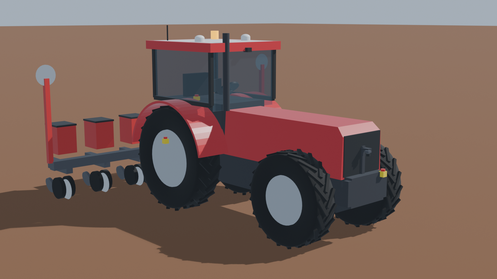
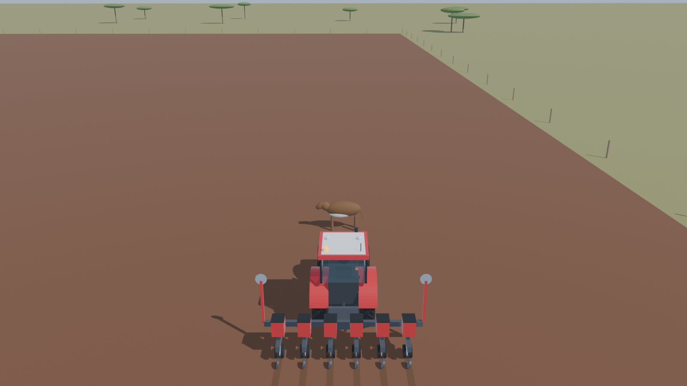
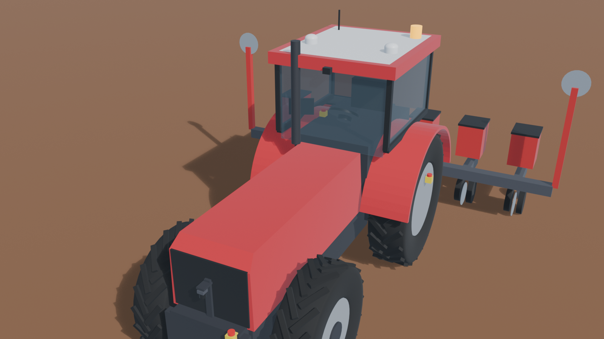
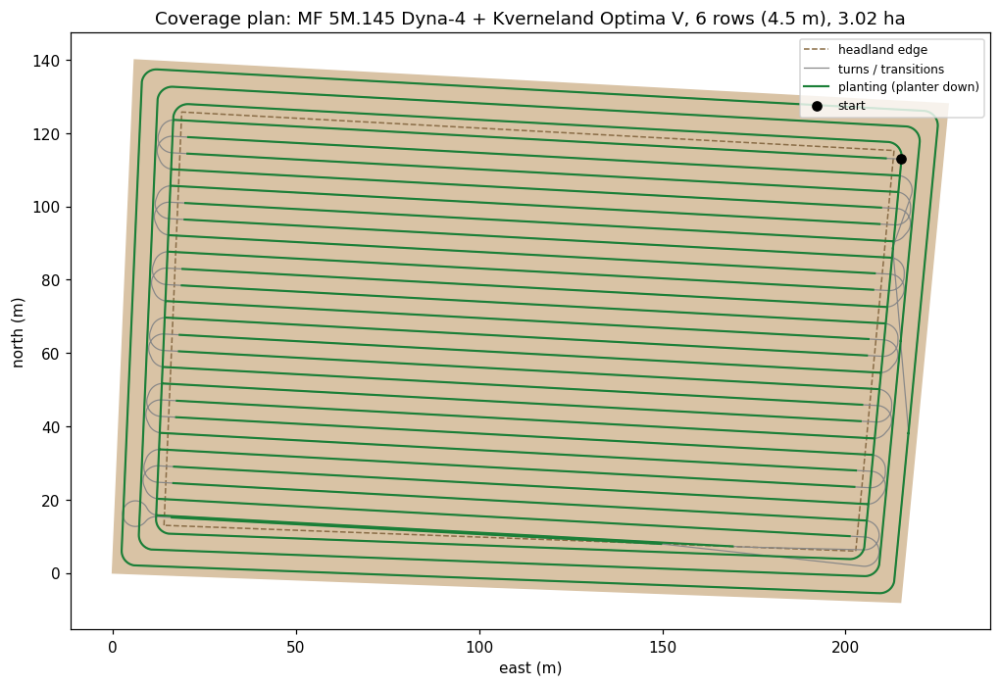

# JBJ autonomous tractor sim

A full engineering simulation of a **retrofit autonomy kit on Massey Ferguson tractors** for JBJ Machinery (South Africa):
the **MF 7615, MF 5M.145 and MF 8732**, planting maize with a **Kverneland Optima V 6-row planter** on a 3 ha field near
Schweizer-Reneke.

It runs on **ROS 2 Lyrical + Gazebo Jetty** with physics, sensors and the real dimensions of each tractor. The same
models are rendered in **Blender** for the videos. Every number that comes from a manufacturer is listed with its source;
everything that is a guess is marked **ASSUMPTION** and needs measuring on a real tractor.



## Results (MF 5M.145 + Kverneland Optima V, ground truth from Gazebo)

| Test | What the tractor did |
|---|---|
| Planting accuracy (RTK) | **1.1-1.4 cm** average off the line, **95 % within 2.1 cm** (the F200 is sold as 2.5 cm) |
| Cow standing in the path, 25 m ahead | Slowed, then **stopped 3.6 m short**; drove on by itself 5 s after the cow walked away |
| Person walking across, 22 m ahead | Slowed to 3 km/h at 14.8 m; the person crossed 5.7 m ahead; no stop needed; back to full speed |
| Operator presses the remote e-stop at 7 km/h | **Standing still after 1.5 s / 1.6 m** |
| Remote's radio signal lost | Stopped by itself: **standing after 1.9 s / 2.4 m** (0.5 s timeout + braking) |
| RTK corrections lost | Stop triggered after 1.2 s, **standing after 2.5 s / 3.4 m**; restarted by itself 4 s after RTK came back |
| Steering motor jams at 8 deg | Off-track stop 3 s later, **standing after 4.3 s**; max 1.0 m off the line, never left the field |

Every run, with plots and the 10 Hz log: [results/SUMMARY.md](results/SUMMARY.md). Planting the whole field and the
MF 7615 / MF 8732 runs are added there as they finish.



## What's in the sim

| | Real part / data | Source |
|---|---|---|
| Tractors | **MF 7615** (140/150 hp, Dyna-4/6/VT), **MF 5M.145 Dyna-4** (145 hp, default), **MF 8732 Dyna-VT** (320 hp): the three tractors JBJ uses | MF South Africa / Africa brochures, Traktorenlexikon, tractordata.com: wheelbase, length, roof height, tyre sizes, steering angle or turning radius, mass |
| Planter | Kverneland Optima V, 6 rows x 0.75 m = **4.5 m** working width | Kverneland range brochure / press release |
| Steering | **Sveaverken F200** electric steering-wheel autosteer (380 mm wheel, 12/24 V, 15-20 Nm) + wheel-angle sensor | sveaverken.com product pages |
| Position | Dual-antenna RTK GNSS, 10 Hz, 1 m antenna baseline: **1 cm** RTK, 25 cm float, 1.5 m without corrections, **0.15 deg** heading | u-blox ZED-F9P datasheet, ArduSimple heading kits |
| Obstacles | **Livox Mid-360** lidar: 40 m range (10 % reflectivity), 360 x 59 deg field of view, 10 Hz, 2 cm range noise. Mounted **upside down** on the front at 1.3 m so it looks at the ground ahead | livoxtech.com/mid-360/specs |
| Field | 3.02 ha, real location 27.205 S, 25.360 E (~1,290 m), fence posts 1.5 m outside the field edge | specs/field.json |

The tractor geometry is computed, not drawn: tyre diameters come from the tyre codes (e.g. 460/85 R38 = 1.747 m), the
minimum turning radius from the 55 deg steering angle with Ackermann geometry. The result is checked against MF's own
turning figure: 4.80 m outer turning radius computed for the MF 7615 vs 4.8 m published.

| Tractor | Wheelbase | Tyres (front / rear) | Track (setting) | Mass | Min. turn radius (rear axle, computed) | Headland the planner needs |
|---|---|---|---|---|---|---|
| **MF 7615** | 2.870 m | 380/85 R28 / 460/85 R38 | 1.5 m | 6,650 kg | 2.91 m (outer wheel 4.80 m = MF's 4.8 m) | 4 passes (18 m) |
| **MF 5M.145 Dyna-4** | 2.630 m | 380/85 R28 / 460/85 R38 | 1.5 m | 4,000 kg | 2.59 m | 3 passes (13.5 m) |
| **MF 8732 Dyna-VT** | 3.090 m | 600/70 R28 / 650/85 R38 | 2.25 m | 10,800 kg | 3.72 m (steering angle 50 deg = ASSUMPTION) | 6 passes (27 m) |

The headland grows with the tractor: the planner adds headland passes until every turn keeps the tractor and planter
inside the field's 1 m safety margin with 0.3 m to spare, as a farmer would leave a wider headland for a bigger tractor.
(A 320 hp MF 8732 would normally pull a much wider planter than 6 rows; the same planter is used for all tractors here.)

**Assumptions to measure on the real tractor** (in `specs/kit.json` and `specs/tractors.json`): front-wheel steering
speed through the motor (25 deg/s) and its lag (0.15 s), braking deceleration on soil (1.5 m/s^2), remote-signal timeout
(0.5 s), planting speed (7 km/h), planter mass and length, tyre friction, the MF 8732's steering angle (50 deg) and the
ground clearance of the MF 7615 / 8732. The MF 7615's steering angle (53 deg) is worked out from its published 4.8 m
turning radius.



## How it works

```
 Gazebo Jetty (physics, 500 Hz)                       ROS 2 Lyrical nodes (sim time)
 ─────────────────────────────                        ──────────────────────────────
 MF tractor model (real geometry, Ackermann)          gnss_receiver      2 antennas -> RTK error model -> rear-axle pose + heading
   2 x NavSat antennas on the cab roof  ── bridge ──▶ path_follower      pure pursuit at 10 Hz, planter up/down
   gpu_lidar = Livox Mid-360 (upside down)  ───────▶ safety_supervisor  can always stop the tractor:
   ground truth odometry  ─────────────────────────▶   e-stop, remote signal lost, RTK lost, obstacle in the path,
 field world (lat/lon of Schweizer-Reneke)              off-track, about to leave the field (geofence); slows for objects
 cow / person spawned and moved by scenarios  ◀────── vehicle_interface  steering-motor speed + lag, braking limits -> wheels
                                                      scenario_runner    plays operator, remote, animals, GNSS outages; scores the run
 coverage planner (before the run): back-and-forth passes parallel to the longest edge, skip-one order, Dubins turns
 (4 m, tightened to 3.5 / 3 m only where the planter would swing past the field edge), 3 headland laps planted last.
```



## Build plan for a real tractor (summary)

Full plan with the wiring, the safety chain, per-tractor notes and the field test steps: [docs/BUILD_PLAN.md](docs/BUILD_PLAN.md).
The sim mirrors what would be bolted on. Rough prices are public list prices in Oct 2026, to be confirmed with quotes.

| Part | Example | Rough price |
|---|---|---|
| Steering + RTK | Electric steering-wheel autosteer (Sveaverken F200 class, about EUR 4,500) or an open RTK heading kit (ArduSimple simpleRTK2B Heading, from about EUR 414) + own steering controller | |
| Main computer | NVIDIA Jetson Orin Nano Super (USD 249) or a rugged mini PC | USD 150-350 |
| Vehicle I/O | Teensy 4.1 / ESP32 + CAN transceiver + relays | USD 50-100 |
| Obstacle sensor | Livox Mid-360 (USD 979) or Mid-360L (about EUR 739) | |
| Remote e-stop | Industrial radio remote with a stop that also triggers when the signal is lost (USD 170+); certified wireless e-stops are quote-only | |
| E-stops, safety relay, engine-stop relay, beacon, 4G router, enclosure, cables | Standard industrial parts | USD 400-700 |

**About USD 2,000-4,000 per tractor on top of the autosteer**, before speed/shuttle/hitch control. Pick tractors where
direction, speed and hitch are already electronic (MF Dyna-4 power shuttle + Electronic Linkage Control), so the kit
controls them with wiring instead of mechanical actuators. The safety layer stays independent of the computer: a hard-wired
e-stop chain that cuts drive whatever the software does.

**Testing order on the real machine:** this sim -> bench test of the I/O board and e-stop chain -> tractor on stands
(wheels off the ground) -> open field at walking speed with a person on the remote e-stop -> supervised autonomy with the
geofence on.

## Run it

Needs Windows 11 + WSL Ubuntu 26.04 (or Ubuntu 26.04), ROS 2 Lyrical and Gazebo Jetty.

```bash
sudo bash tools/wsl_setup.sh install          # ROS 2 Lyrical + Gazebo + Python deps
bash tools/sim.sh build                        # copies the repo to ~/jbj and builds the ROS package
bash tools/sim.sh run cow mf_5m_145            # one scenario, results copied to results/
bash tools/sim.sh run full_field mf_7615 true  # watch it in the Gazebo GUI
bash tools/sim.sh all                          # every scenario
python3 tools/summarize_results.py             # results/SUMMARY.md
```

Scenarios: `full_field`, `cow`, `person`, `remote_estop`, `remote_lost`, `rtk_loss`, `steering_fault`.
Tractors: `mf_7615`, `mf_5m_145` (default), `mf_8732`.

Models and videos are generated from the same specs:

```bash
blender -b --factory-startup -P blender/build_models.py -- --render 1   # tractors, kit, planter, cow, person -> Gazebo meshes + renders
python tools/gen_models.py                                               # Gazebo SDF models + field world
blender -b --factory-startup -P blender/replay.py -- --run results/cow_mf_5m_145 --cam chase --speed 1 --seconds 30
bash tools/encode_video.sh cow_mf_5m_145                                 # frames + HUD -> media/cow_mf_5m_145.mp4
python3 tools/tune_follower.py                                           # fast offline check of the steering loop
```

## Limits (what this sim does not prove yet)

- Flat field: no slopes, ruts or side-hill drift, so no terrain compensation is needed yet. Real fields will need roll compensation of the antenna position (antennas are 2.8 m up).
- Tyres are rigid cylinders with one friction value; no soil compaction or slip model beyond Gazebo's contact friction.
- The lidar is modelled as a uniform 720 x 40 ray pattern; the real Mid-360 scans a non-repetitive pattern. No dust, rain or crop residue in the point cloud.
- Speed, shuttle and hitch are commanded directly (the plugin drives the wheels); a real tractor needs its electronic shuttle, throttle and hitch wired to the I/O board.
- The planter is a visual + working-width model, not a dynamic implement.
- Obstacles: the kit stops for anything in its path corridor above 0.3 m; it does not tell a person from a cow.

(c) 2026 Sumith Shridhar. All rights reserved for now; licence to be agreed with JBJ Machinery. Tractor and implement
names are used to describe the real machines being simulated; no logos are reproduced.
